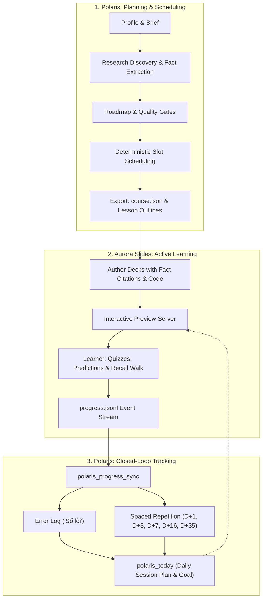

[Tiếng Việt](README.vi.md)

# Polaris MCP

Polaris is a Model Context Protocol (MCP) server and command-line interface (CLI) that gives coding agents (Claude Code, Google Antigravity, Cursor) the deterministic structure, persistence, research discovery, source capture, schedule planning, slide deck export, and quality gates to build personalized, evidence-based study courses.

Sister project to [Aurora Slides MCP](https://github.com/DuongNAD/aurora-slides-mcp), which renders the presentations.

## Principles

1. **The agent reasons, Polaris structures:** Every artifact is strictly validated with Zod schemas and rendered into Markdown or Aurora course inputs. Typos produce actionable, corrective error messages with "did you mean...".
2. **Evidence first:** Every factual bullet in a roadmap cites verified facts; every fact points to a source plus a precise locator (timestamp `[mm:ss]`, page `[p. N]`, section, line numbers). Labels distinguish primary truth (`course`), extensions (`extension`), and unverified claims (`unverified`).
3. **Learner fit:** The learner profile drives language (Vietnamese by default with correct diacritics), weekly study slots, blackout periods, session recipes (30m, 60m, 90m lab), study techniques (theory -> memory anchors -> paper notebook -> practice easy-to-hard -> recall walk; predict-then-run for code), and spaced review intervals.
4. **Quality gates:** Automated gates verify brief completeness, source labels and quality scores, fact locators, outcome coverage, dependency DAG cycles, and flag overclaims.
5. **Files, not databases:** Plain JSON and Markdown inside the subject folder (`polaris/brief.json`, `sources.json`, `facts.json`, `roadmap.json`, `schedule.json`, `course-map.json`, `tasks-map.json`, `reviews.json`, `errorlog.md`, `captures/`, `research/`, `lessons/`). Captured third-party text is kept local and git-ignored.

## Architecture & Directory Layout

### Hub Level (`POLARIS_HUB`, default: `D:/02_Learning_Knowledge`)
```
<hub>/
├── AGENTS.md                # Global hub rules & agent guidance
├── ACTIVE_LEARNING.md       # Priority learning goals, P0 deadlines & checkpoints
├── TASKS.md                 # Workspace tasks
└── .polaris/
    └── learner.json         # Learner profile (slots, blackouts, recipes, taste, commitments)
```

### Subject Level (`<subject>/`)
```
<subject>/
├── 04_Roadmaps/
│   └── ROADMAP.md           # Rendered gold-standard roadmap in Vietnamese (with calendar & reviews)
├── 05_Slides/
│   └── <slug>/
│       └── course.json      # Aurora Slides course specification
├── TASKS.md                 # Subject tasks (synced under '## Polaris')
└── polaris/
    ├── .gitignore           # Ignores captures/ and .cache/
    ├── brief.json           # Subject, goal, measurable outcomes with check criteria, hoursPerWeek
    ├── sources.json         # Registry of primary course materials, papers, web pages, local files
    ├── facts.json           # Discrete factual claims with locators and source IDs
    ├── roadmap.json         # Module structure, practice tiers, self-check questions, checkpoints
    ├── schedule.json        # Deterministic slot schedule, session dates, and when labels
    ├── course-map.json      # Stable module/lesson ID to Aurora lesson mapping
    ├── tasks-map.json       # Synced task ID to hub task mapping (duplicate prevention)
    ├── reviews.json         # Spaced review tracking schedule (D+1, D+3, D+7, D+16, D+35)
    ├── errorlog.md          # Learner error log ("Sổ lỗi") with predict-gap reviews
    ├── .cache/              # 24-hour search query cache (git-ignored)
    ├── research/            # Generated research shortlist files (e.g. 2026-10-10-ai-agents.md)
    ├── captures/            # Full-text extractions of web pages, arXiv PDFs, and YouTube transcripts (git-ignored)
    │   ├── S1.md
    │   └── S2.md
    └── lessons/             # Lesson outline skeletons for review before deck generation
        ├── 01-tong-quan.outline.md
        └── 02-kien-truc.outline.md
```

## Tools (v0.3.0)

Polaris exposes 20 specialized MCP tools across 5 major functional domains:

### 1. Profile & Setup
| Tool | Description |
|---|---|
| `polaris_guide` | Documentation on workflow, pipeline, quality gates, source policy, research engine, schedule, export, tracking, progress sync, aurora workflow, and learner method. |
| `polaris_profile` | Read (`get`) or update (`update`) learner preferences, weekly slots (`slots`), blackout dates (`blackouts`), and session recipes. |
| `polaris_start` | Initialize `<subject>/polaris/` and save validated `brief.json` with measurable outcomes. |

### 2. Research & Sources
| Tool | Description |
|---|---|
| `polaris_find` | Discover research material across keyless providers with transparent scoring, reasons, and open-access links. |
| `polaris_research` | Multi-query research investigation across providers with 24h caching, de-duplication, ranking, shortlist generation, and optional auto-add. |
| `polaris_source_add` | Register sources (web URLs, arXiv IDs, local files) with automatic text capture and de-duplication. |
| `polaris_capture` | Capture source full-text content (PDF via `pdftotext` with page markers, YouTube transcripts via `yt-dlp` with timestamps, web/Wikipedia text). |
| `polaris_sources` | List, search, filter, or update sources in `sources.json`. |

### 3. Facts, Roadmap & Quality Gates
| Tool | Description |
|---|---|
| `polaris_fact_add` | Record discrete claims with source IDs and precise locators (timestamp, page, section, lines). |
| `polaris_facts` | Search and filter verified facts by query, module ID, or source ID. |
| `polaris_roadmap_save` | Validate roadmap through quality gates, save `roadmap.json`, and render `ROADMAP.md`. |
| `polaris_check` | Run the complete quality gate audit across brief, sources, facts, roadmap, schedule, and course export. |

### 4. Scheduling & Slide Export
| Tool | Description |
|---|---|
| `polaris_schedule` | Deterministically fit module hours into weekly slots, skip blackouts and P0 deadlines from `ACTIVE_LEARNING.md`/`TASKS.md`, insert review sessions every N weeks, write `schedule.json`, update `ROADMAP.md` 3.2, and return Vietnamese `when` labels. |
| `polaris_export_course` | Export Aurora Slides `course.json` (splitting > 2.5h modules, alternating themes, Phosphor icons) with idempotent merging and generate lesson outline skeletons in `polaris/lessons/<dir>.outline.md`. |

### 5. Tracking & Learning Hub Sync
| Tool | Description |
|---|---|
| `polaris_tasks_sync` | Sync scheduled lessons and module checkpoints into `<subject>/TASKS.md` under `## Polaris` in hub format (`- [ ] [Deadline: ...] [Priority: P2] ...`) with duplicate prevention. |
| `polaris_progress_sync` | Read Aurora Slides interactive learning events from `progress.jsonl` (or exported files), map lessons to modules, add error log entries for wrong quizzes, predict gaps, and missed palace stations, and schedule spaced reviews (D+1, D+3, D+7, D+16, D+35) for completed lessons. Idempotent. |
| `polaris_errorlog_add` | Record prediction errors and gaps into `polaris/errorlog.md` ("Sổ lỗi") and schedule spaced review iterations. |
| `polaris_lesson_done` | Record lesson completion in `polaris/reviews.json` and schedule spaced reviews after 1, 3, 7, 16, and 35 days. |
| `polaris_review_due` | Query lessons and error log items due for review on or before a given date, ordered oldest first. |
| `polaris_today` | Generate a 60- or 30-minute session plan following learner session recipe (due reviews, next scheduled lesson with slide & outline paths, practice tier with DoD). Optionally write or replace `## Today's Dynamic Goal` in `<hub>/ACTIVE_LEARNING.md`. |

## Polaris + Aurora

Polaris and [Aurora Slides MCP](https://github.com/DuongNAD/aurora-slides-mcp) operate together as a closed-loop personalized learning ecosystem:



### Side-by-Side Installation

#### Claude Code CLI (`claude mcp add`)
```bash
claude mcp add polaris -- node D:/03_Development_Projects/ai_agents/polaris_mcp/dist/polaris.mjs
claude mcp add aurora-slides -- node D:/03_Development_Projects/Slide_Projects/my_projects/aurora_slides_mcp/dist/aurora.mjs
```

#### Antigravity Configuration (`mcp_config.json`)
```json
{
  "mcpServers": {
    "polaris": {
      "command": "node",
      "args": ["D:/03_Development_Projects/ai_agents/polaris_mcp/dist/polaris.mjs"],
      "env": {
        "POLARIS_HUB": "D:/02_Learning_Knowledge",
        "POLARIS_TOOLCHAIN": "C:/Users/Admin/AppData/Local/Packages/Claude_pzs8sxrjxfjjc/LocalCache/Local/aurora-slides/toolchain"
      }
    },
    "aurora-slides": {
      "command": "node",
      "args": ["D:/03_Development_Projects/Slide_Projects/my_projects/aurora_slides_mcp/dist/aurora.mjs"],
      "env": {
        "AURORA_TOOLCHAIN": "C:/Users/Admin/AppData/Local/Packages/Claude_pzs8sxrjxfjjc/LocalCache/Local/aurora-slides/toolchain"
      }
    }
  }
}
```

## Research Engine

Polaris includes an autonomous discovery and research engine designed for academic and developer learning:

### Keyless Providers
- **`openalex`**: Works, publication years, citations, inverted-index reconstructed abstracts, and open-access PDF URLs.
- **`arxiv`**: Atom XML API with 1 call / 3s rate limit; metadata and full-text PDF download.
- **`semanticscholar`**: Paper metadata, TL;DR summaries, citation counts, and OA links with exponential backoff on HTTP 429/503.
- **`crossref`**: DOIs, journals, books, and citation references.
- **`wikipedia`**: Vietnamese (`vi`) and English (`en`) summaries and plain-text extracts.
- **`github`**: Official repositories and code implementations (10 req/min unauthenticated rate limit).
- **`youtube`**: Public lecture search and transcript extraction via `yt-dlp`.
- **`brave`**: Optional general web search if `BRAVE_API_KEY` is provided.

### Ranking Factors & Reasons
Every result receives a transparent score (0-100) and evaluation reasons:
- **Type Priority**: Primary course > Specs & papers > Books & tutorials > Videos, repos, web.
- **Relevance**: Exact query and module keyword matches in titles and abstracts.
- **Authority**: Log-scaled citations (`Math.log10(citations + 1)`), GitHub stars, and peer-reviewed venues (ICLR, NeurIPS, Nature, etc.).
- **Recency**: Boosts recent publications (>= 2022) and respects `year_from` filters.
- **Open Access**: +10 score for open-access PDFs and freely accessible content.
- **Language**: Matches learner language preferences (Vietnamese / English).

## Scheduling & Aurora Integration

1. **Deterministic Calendar Fit (`polaris_schedule`):**
   - Topological sorting of module dependencies (DAG).
   - Module hours mapped into the learner's weekly study slots (e.g. Tue 30m, Sat 60m).
   - Skips configured blackout intervals.
   - Automatically detects unchecked P0 deadlines in the learning hub (`ACTIVE_LEARNING.md` and `TASKS.md`) and clears both the deadline day and the day before.
   - Inserts interleaved review sessions every `interleave_every` weeks (default 4).
   - Re-renders Section 3.2 in `ROADMAP.md` as an exact weekly calendar table with Vietnamese dates.

2. **Aurora Slides Course Export (`polaris_export_course`):**
   - Generates strict `course.json` compatible with Aurora Slides CLI/MCP.
   - Splits long modules (> 2.5 hours or `lessons: 2`) into manageable sub-lessons (a/b).
   - Alternates visual themes (`aurora`, `midnight`, `daylight`, `titanium`, `ocean`, `sunset`, `forest`, `paper`, `liquid`) between neighbouring lessons.
   - Selects contextual Phosphor duotone icons.
   - Idempotently merges with existing courses via `course-map.json`.
   - Generates detailed lesson outline skeletons in Vietnamese (`polaris/lessons/<dir>.outline.md`) featuring facts, quiz distractors from misconceptions, DoD practice exercises, memory palace anchors, 4-8 line notebook summaries, and slide plans.

3. **Learning Hub Synchronization (`polaris_tasks_sync`):**
   - Appends lesson and checkpoint tasks to `<subject>/TASKS.md` under `## Polaris`.
   - Formats tasks strictly: `- [ ] [Deadline: YYYY-MM-DD 23:59] [Priority: P2] Học bài <n>: <title>`.
   - Preserves line endings and prevents duplicates using `polaris/tasks-map.json`.

4. **Closed-Loop Progress & Spaced Repetition (`polaris_progress_sync`, `polaris_today`):**
   - `polaris_progress_sync` reads `<course_dir>/progress.jsonl` from Aurora preview server or exported files.
   - Ingests incorrect quiz answers, predict-run gaps, and missed memory palace stations into `polaris/errorlog.md` ("Sổ lỗi").
   - Schedules spaced repetition reviews at D+1, D+3, D+7, D+16, and D+35 in `polaris/reviews.json`.
   - `polaris_today` calculates 30m/60m session plans and writes `## Today's Dynamic Goal` to the hub's `ACTIVE_LEARNING.md`.

## Agent Prompts & Workflow

Polaris provides 4 prompt workflows:
- **`new_course`**: The full 8-step gated pipeline: Profile -> Brief & Diagnostic -> Research Shortlist -> Facts Extraction -> Roadmap Generation -> Schedule Planning -> Course & Outline Export -> Task Sync -> First Lesson Generation with Aurora.
- **`next_lesson`**: Daily learning loop: Sync progress -> Plan today's session -> Pick the next scheduled lesson -> Refresh outline -> Build presentation deck with Aurora tools adhering to accuracy and fact citations -> Audit slide deck -> Sync tasks -> Record review.
- **`review`**: Active recall session: Ingest latest progress events -> Query due spaced reviews -> Guide 5-10 minute active recall session for error log items and lesson summaries.
- **`research`**: Targeted deep-dive research hunt for a specific module across all keyless providers.

## MCP Server Connection

### For Claude Code
Add to your project's `.mcp.json` or `~/.claude.json`:
```json
{
  "mcpServers": {
    "polaris": {
      "command": "node",
      "args": ["D:/03_Development_Projects/ai_agents/polaris_mcp/dist/polaris.mjs"],
      "env": {
        "POLARIS_HUB": "D:/02_Learning_Knowledge",
        "POLARIS_TOOLCHAIN": "C:/Users/Admin/AppData/Local/Packages/Claude_pzs8sxrjxfjjc/LocalCache/Local/aurora-slides/toolchain"
      }
    }
  }
}
```

### For Google Antigravity
Add to your Antigravity MCP server configuration:
```json
{
  "polaris": {
    "command": "node",
    "args": ["D:/03_Development_Projects/ai_agents/polaris_mcp/dist/polaris.mjs"],
    "env": {
      "POLARIS_HUB": "D:/02_Learning_Knowledge",
      "POLARIS_TOOLCHAIN": "C:/Users/Admin/AppData/Local/Packages/Claude_pzs8sxrjxfjjc/LocalCache/Local/aurora-slides/toolchain"
    }
  }
}
```

## CLI Usage

Run directly via Node.js or `bin/polaris`:

```bash
# Start MCP server on stdio
node dist/polaris.mjs

# Run quality gate check on a subject folder
node dist/polaris.mjs check <subject_dir>

# Re-render ROADMAP.md from polaris/roadmap.json
node dist/polaris.mjs render <subject_dir>

# Compute schedule and update ROADMAP.md section 3.2
node dist/polaris.mjs schedule <subject_dir>

# Export Aurora Slides course.json and lesson outline skeletons
node dist/polaris.mjs export <subject_dir>

# Sync scheduled lessons into <subject>/TASKS.md
node dist/polaris.mjs tasks <subject_dir>

# Sync Aurora progress events into error log and spaced reviews
node dist/polaris.mjs progress <subject_dir> [course_dir]

# Generate daily session plan and print Today's Dynamic Goal
node dist/polaris.mjs today <subject_dir> [date]

# View guide topics (e.g. overview, pipeline, gates, sources, roadmap, research, schedule, export, tracking, progress, aurora, learner, rules)
node dist/polaris.mjs guide [topic]

# Version & help
node dist/polaris.mjs version
node dist/polaris.mjs help
```

## Quality Gates

- **Brief:** `hoursPerWeek` and `start` date set; every outcome has a testable `check` verification string.
- **Sources:** At least one source labeled `course`; all sources have labels and quality scores (1-5) with reasons.
- **Facts:** Every fact references a valid source ID with a non-empty locator; numerical and date claims must have `crossCheck` sources or carry the `unverified` label.
- **Roadmap:** Every brief outcome is covered; modules have `why`, ≥ 2 outputs, core points citing facts, ≥ 1 misconception with fix, materials fitting module hours, 3 practice tiers (`warmup`, `core`, `challenge`) with DoD, ≥ 4 self-check questions with predict questions when code is present, checkpoints, and no circular dependency cycles.
- **Language:** Flags absolute overclaims ("100%", "luôn luôn", "tuyệt đối", "always", "every model").

## Version History

| Version | Description |
|---|---|
| **0.3.0** | Closed-loop integration with Aurora Slides: `polaris_progress_sync` (ingesting quiz, predict, recall, complete events into Sổ lỗi & spaced reviews), `polaris_today` (daily session planner & Active Learning Hub updater), `review` prompt, `progress` and `aurora` guide topics. |
| **0.2.0** | Autonomous research discovery engine across 8 keyless providers (OpenAlex, arXiv, Semantic Scholar, CrossRef, Wikipedia, GitHub, YouTube, Brave), ranking with transparent evaluation reasons, 24h caching, Review Gate, and full-text capture tools. |
| **0.1.0** | Initial release: Evidence-based study course creation, profile management, brief validation, fact extraction, 10-section ROADMAP rendering, deterministic scheduling, and Aurora course export. |

## Toolchain & Build

Polaris adheres to clean drive separation for large-cluster drives (e.g. exFAT): `node_modules` lives in `POLARIS_TOOLCHAIN` (falling back to `%LOCALAPPDATA%/aurora-slides/toolchain`).

```powershell
# In PowerShell:
$env:POLARIS_TOOLCHAIN = "C:\Users\Admin\AppData\Local\Packages\Claude_pzs8sxrjxfjjc\LocalCache\Local\aurora-slides\toolchain"

# Type check & build single bundled file:
node scripts/build.mjs --check

# Run end-to-end tests:
node scripts/e2e.mjs
```

## License

MIT License - Copyright (c) 2026 DuongNAD.

