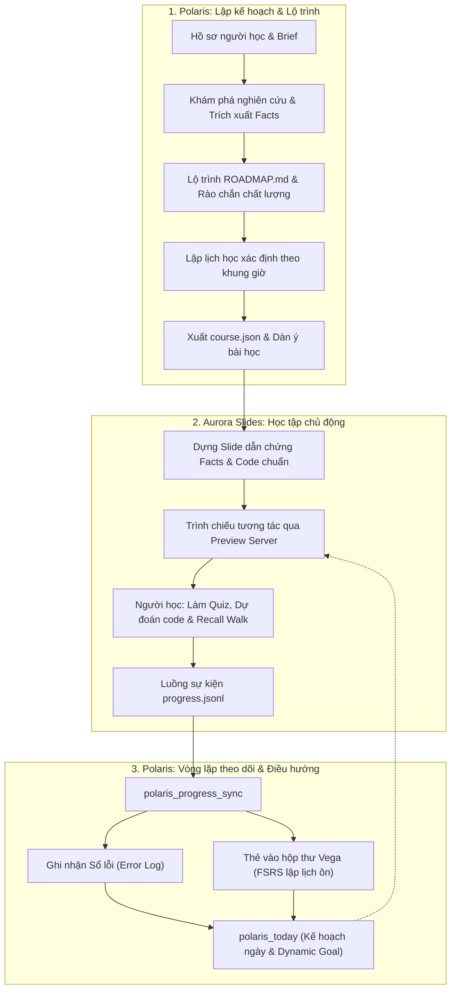

[English](README.md)

<p align="center"></p>

# Polaris MCP

*Được đặt tên theo Polaris, ngôi sao Bắc Cực: cả bầu trời xoay quanh nó, tựa như lộ trình giữ cho mỗi bài học luôn đúng hướng.*

Polaris là một máy chủ Model Context Protocol (MCP) và giao diện dòng lệnh (CLI) giúp các coding agent (Claude Code, Google Antigravity, Cursor) có được cấu trúc, sự bền vững dữ liệu, công cụ khám phá nghiên cứu (research engine), thu thập tài liệu, lập lịch trình học tập, xuất khóa học trình chiếu và các rào chắn chất lượng (quality gates) để xây dựng lộ trình học tập cá nhân hóa dựa trên bằng chứng (evidence-based).

Dự án song hành cùng [Aurora Slides MCP](https://github.com/DuongNAD/aurora-slides-mcp) dùng để dựng bài giảng trình chiếu.

## Nguyên tắc cốt lõi

1. **Agent tư duy, Polaris định hình cấu trúc:** Mọi dữ liệu đều là JSON được kiểm thực chặt chẽ qua Zod schema và xuất ra Markdown hoặc định dạng đầu vào cho Aurora. Lỗi nhập liệu đi kèm gợi ý sửa đổi chính xác ("có phải ý bạn là...").
2. **Dựa trên bằng chứng (Evidence first):** Mọi ý kiến thức cốt lõi đều dẫn chiếu đến facts; mỗi fact đều trỏ về một source kèm định vị cụ thể (mốc thời gian video `[mm:ss]`, số trang `[p. N]`, mục, khoảng dòng). Nhãn phân loại rõ ràng: **[Khóa học]** (nguồn sự thật chính thức), **[Mở rộng]** (nguồn bên ngoài đã xác minh), **(chưa xác minh)** (chưa kiểm chứng).
3. **Phù hợp với người học:** Hồ sơ người học (Learner Profile) quy định ngôn ngữ (tiếng Việt chuẩn dấu), khung giờ học trong tuần (`slots`), ngày bận (`blackouts`), công thức buổi học (30 phút, 60 phút, lab 90 phút), phương pháp tiếp thu (lý thuyết -> neo ghi nhớ -> sổ tay giấy -> thực hành từ dễ đến khó -> đi dạo gợi nhớ; predict-then-run đối với code), và bộ máy ôn tập (một bộ lập lịch thích nghi duy nhất là Vega FSRS, hoặc các mốc D+ cố định cũ).
4. **Rào chắn chất lượng (Quality gates):** Kiểm tra tự động tính đầy đủ của brief, nhãn và điểm chất lượng nguồn, định vị fact, độ phủ đầu ra, đồ thị phụ thuộc module không vòng lặp (DAG), và cảnh báo các khẳng định quá mức.
5. **Tập tin thuần, không dùng cơ sở dữ liệu phức tạp:** Lưu trữ JSON và Markdown trực tiếp trong thư mục môn học (`polaris/brief.json`, `sources.json`, `facts.json`, `roadmap.json`, `schedule.json`, `course-map.json`, `tasks-map.json`, `reviews.json`, `errorlog.md`, `captures/`, `research/`, `lessons/`). Bản chụp văn bản và cache được giữ cục bộ và bỏ qua trong git (`.gitignore`).

## Cấu trúc thư mục

### Cấp độ Hub trung tâm (`POLARIS_HUB`, mặc định: `D:/02_Learning_Knowledge`)
```
<hub>/
├── AGENTS.md                # Quy tắc chung của hub và hướng dẫn cho AI agent
├── ACTIVE_LEARNING.md       # Mục tiêu ưu tiên, hạn chót P0 và các checkpoint
├── TASKS.md                 # Quản lý tác vụ toàn hub
├── .polaris/
│   └── learner.json         # Hồ sơ người học (khung giờ, ngày bận, công thức buổi học, phong cách, method.reviewEngine)
└── .vega/                   # Dữ liệu cá nhân của Vega (git-ignored); Polaris chỉ thả file vào inbox/
    └── inbox/               # Thẻ ứng viên từ Polaris (hợp đồng vega-card-inbox.v1), Vega nhập khi chạy vega_sync
```

### Cấp độ môn học (`<subject>/`)
```
<subject>/
├── 04_Roadmaps/
│   └── ROADMAP.md           # Lộ trình học Markdown chuẩn tiếng Việt 10 mục (kèm lịch & ôn tập)
├── 05_Slides/
│   └── <slug>/
│       └── course.json      # Khóa học Aurora Slides
├── TASKS.md                 # Tác vụ của môn học (đồng bộ dưới mục '## Polaris')
└── polaris/
    ├── .gitignore           # Bỏ qua captures/ và .cache/ cũ
    ├── brief.json           # Mục tiêu, đầu ra kiểm tra được, số giờ/tuần, nguồn sự thật
    ├── sources.json         # Sổ đăng ký nguồn tài liệu (video, bài báo, trang web, ghi chú)
    ├── facts.json           # Các sự thật được trích xuất kèm định vị và ID nguồn
    ├── roadmap.json         # Cấu trúc module, 3 tầng thực hành, câu hỏi tự kiểm tra, checkpoint
    ├── schedule.json        # Lịch học xác định theo slot, ngày học và nhãn when
    ├── course-map.json      # Bản đồ ánh xạ ổn định giữa module/bài học và Aurora lesson
    ├── tasks-map.json       # Bản đồ ánh xạ task ID với TASKS.md (chống trùng lặp)
    ├── reviews.json         # Chỉ bộ máy fixed: các mốc D+1, D+3, D+7, D+16, D+35 của chính Polaris (mốc cũ được giữ nguyên, không chuyển đổi)
    ├── progress-state.json  # Trạng thái đồng bộ lũy đẳng (sự kiện đã xử lý, bài học đã hoàn thành)
    ├── errorlog.md          # Sổ lỗi người học; với Vega, mỗi mục ghi tên thẻ Vega thay vì các mốc D+
    ├── research/            # Các file danh sách rút gọn tài liệu (vd: 2026-10-10-ai-agents.md)
    ├── captures/            # Bản trích xuất toàn văn từ web/arXiv/YouTube (git-ignored)
    │   ├── S1.md
    │   └── S2.md
    └── lessons/             # Dàn ý bài học skeleton để duyệt trước khi dựng slide
        ├── 01-tong-quan.outline.md
        └── 02-kien-truc.outline.md
```

> **Ghi chú về Cache API:** Toàn bộ dữ liệu bộ nhớ đệm tìm kiếm API 24 giờ được lưu tập trung tại cache hệ thống (`%LOCALAPPDATA%/polaris/cache` hoặc `POLARIS_CACHE_DIR`), giúp tiết kiệm dung lượng cụm đĩa exFAT.

## Danh sách công cụ (v0.4.0)

Polaris cung cấp 20 công cụ MCP chia theo 5 nhóm chức năng:

### 1. Hồ sơ & Khởi tạo
| Công cụ | Mô tả |
|---|---|
| `polaris_guide` | Tra cứu tài liệu hướng dẫn quy trình, rào chắn chất lượng, chính sách nguồn, công cụ nghiên cứu, lập lịch, xuất slide, theo dõi, đồng bộ tiến độ Aurora, kế hoạch ngày, quy trình tích hợp và phương pháp học. |
| `polaris_profile` | Đọc (`get`) hoặc cập nhật (`update`) hồ sơ người học, khung giờ tuần (`slots`), ngày bận (`blackouts`), công thức buổi học và bộ máy ôn tập `method.reviewEngine` (`vega` hoặc `fixed`; `null` để bỏ ghi đè). Kết quả `get` kết thúc bằng bộ máy đang có hiệu lực. |
| `polaris_start` | Khởi tạo thư mục môn học, thiết lập `polaris/brief.json` và cấu hình `.gitignore`, hỗ trợ trường `roadmapPath` ("kết xuất lộ trình ra vị trí tùy biến để không bao giờ ghi đè lên file ROADMAP.md của người học"). |

### 2. Nghiên cứu & Nguồn tài liệu (kèm Rào chắn SSRF & Fallback Open Access)
Toàn bộ các yêu cầu mạng ra ngoài (trang web, arXiv, PDF Open Access, Wikipedia, API provider và kiểm tra robots.txt) đều được bảo vệ bởi rào chắn SSRF: chỉ cho phép giao thức `http:` và `https:`; phân giải tên miền qua DNS (`node:dns`) và từ chối các địa chỉ nội bộ/cục bộ (loopback, mạng LAN riêng tư, link-local metadata 169.254.169.254, CGNAT, multicast, các dải dành riêng, IPv4-mapped IPv6 và localhost); theo dõi chuyển hướng thủ công (tối đa 5 bước nhảy) và kiểm tra lại trên từng bước. Sử dụng `POLARIS_ALLOW_PRIVATE_URLS=1` khi cần kiểm thử cục bộ có chủ đích. Khi nguồn có `oaUrl` đã biết, Polaris ưu tiên thu thập bản open-access trước và giữ lại link gốc. Khi gặp URL bị chặn (401/403/429, lỗi mạng với DOI đã biết, hoặc bot wall interstitial < 1500 ký tự kèm dấu hiệu thử thách mạnh), Polaris tự động tìm kiếm bản Open Access hợp lệ qua OpenAlex và Unpaywall, kiểm tra robots.txt cho mọi URL và không bao giờ vượt tường trả phí.

| Công cụ | Mô tả |
|---|---|
| `polaris_find` | Tìm kiếm tài liệu học tập qua các nhà cung cấp không cần API key với điểm số, lý do đánh giá và link Open Access. |
| `polaris_research` | Thực thi nghiên cứu đa truy vấn qua nhiều provider, lưu cache 24h, chống trùng lặp, xếp hạng, xuất file shortlist và tùy chọn tự động thêm nguồn. |
| `polaris_source_add` | Đăng ký và thu thập nội dung từ URL web, mã arXiv hoặc file cục bộ (tự động chống trùng lặp). |
| `polaris_capture` | Thu thập toàn văn tài liệu (PDF qua `pdftotext` có đánh dấu trang `[p. N]`, phụ đề YouTube qua `yt-dlp` có mốc thời gian `[mm:ss]`, văn bản web/Wikipedia). |
| `polaris_sources` | Liệt kê, tìm kiếm, lọc hoặc cập nhật thông tin trong sổ đăng ký nguồn `sources.json`. |

### 3. Sự thật, Lộ trình & Rào chắn chất lượng
| Công cụ | Mô tả |
|---|---|
| `polaris_fact_add` | Ghi nhận các luận điểm sự thật kèm ID nguồn và định vị chính xác (timestamp, trang, mục, dòng). |
| `polaris_facts` | Truy vấn và lọc danh sách fact theo từ khóa, mã module hoặc mã nguồn. |
| `polaris_roadmap_save` | Kiểm tra rào chắn chất lượng, lưu `roadmap.json` và kết xuất file `ROADMAP.md`. |
| `polaris_check` | Chạy toàn bộ bài kiểm tra rào chắn chất lượng cho môn học (brief, sources, facts, roadmap, schedule, export). |

### 4. Lập lịch trình & Xuất bài giảng Aurora
| Công cụ | Mô tả |
|---|---|
| `polaris_schedule` | Khớp thời lượng module vào khung giờ tuần của người học theo topo DAG, bỏ qua ngày bận và hạn chót P0 trong `ACTIVE_LEARNING.md`/`TASKS.md`, chèn buổi ôn xen kẽ mỗi N tuần, lưu `schedule.json`, cập nhật bảng tuần mục 3.2 trong `ROADMAP.md` và trả về nhãn `when` tiếng Việt. |
| `polaris_export_course` | Xuất file `course.json` cho Aurora Slides (tách module > 2.5h, đảo theme luân phiên, chọn icon Phosphor) với cơ chế trộn lũy đẳng, và tạo file dàn ý khung `polaris/lessons/<dir>.outline.md`. |

### 5. Theo dõi tiến độ & Đồng bộ tác vụ Hub
| Công cụ | Mô tả |
|---|---|
| `polaris_tasks_sync` | Đồng bộ các bài học và checkpoint vào `<subject>/TASKS.md` dưới mục `## Polaris` theo định dạng chuẩn hub (`- [ ] [Deadline: ...] [Priority: P2] ...`) và chống trùng lặp. |
| `polaris_progress_sync` | Đọc các sự kiện học tập tương tác từ file `progress.jsonl` của Aurora Slides (hoặc file xuất), tự động đưa lỗi quiz, lệch dự đoán (predict gaps) và trạm trí nhớ bị quên vào Sổ lỗi, rồi giao việc ôn tập cho bộ máy đang có hiệu lực: với `vega`, mỗi lần đồng bộ ghi đúng một file hộp thư mang một thẻ Vega cho mỗi mục mới cùng các thẻ tự kiểm tra của bài học vừa hoàn thành (không thêm gì vào `reviews.json`); với `fixed`, lập lịch ôn D+1, D+3, D+7, D+16, D+35. Nhận diện bỏ qua các sự kiện flashcard "card" của Vega. Hoàn toàn lũy đẳng (idempotent). |
| `polaris_errorlog_add` | Ghi nhận lỗi dự đoán và khoảng cách hiểu vào `polaris/errorlog.md` ("Sổ lỗi"). Với `vega`, dòng ôn tập của mục ghi tên thẻ Vega (`- **Ôn tập:** thẻ Vega ... (FSRS lập lịch)`) và một thẻ được gửi vào hộp thư Vega; với `fixed`, lập lịch các mốc D+. |
| `polaris_lesson_done` | Đánh dấu hoàn thành bài học. Với `vega`, các câu tự kiểm tra của module chứa bài học trở thành thẻ Vega (không có thì không ghi gì); với `fixed`, ghi bài học vào `polaris/reviews.json` và lập lịch ôn sau 1, 3, 7, 16 và 35 ngày. |
| `polaris_review_due` | Truy vấn các mốc ôn cố định cũ trong `polaris/reviews.json` đến hạn trước hoặc vào ngày chỉ định, sắp xếp cũ nhất lên trước. Với `vega`, thêm một dòng số thẻ Vega đến hạn (đọc `<hub>/.vega/cards.json`, chỉ đọc) kèm bước tiếp theo `vega_sync, rồi vega_session`. |
| `polaris_today` | Lập kế hoạch buổi học 60 hoặc 30 phút theo công thức học tập (mục ôn tập đến hạn, số lượng thẻ Vega FSRS đến hạn từ `<hub>/.vega/cards.json` kèm bước tiếp theo "vega_sync, then vega_session to review" và, với `vega`, dòng bộ máy `vega_sync, rồi vega_session`, bài học tiếp theo theo lịch kèm đường dẫn slide và outline, tầng thực hành kèm DoD). Tùy chọn ghi/thay thế khối `## Today's Dynamic Goal` vào file `ACTIVE_LEARNING.md` của Hub. |

## Một bộ máy ôn tập: Vega (v0.4.0)

Việc ôn tập ngắt quãng do **một bộ máy thích nghi duy nhất, Vega (FSRS)**, lập lịch; Polaris không còn tự đặt các mốc cố định D+1/D+3/D+7/D+16/D+35. Polaris giữ Sổ lỗi dễ đọc cho người và giao các mục cần ôn cho Vega qua một hộp thư dùng chung; sau đó người học chạy `vega_sync` rồi `vega_session` (Vega MCP).

**Bộ máy nào có hiệu lực:** `method.reviewEngine` trong hồ sơ người học (`"vega"` hoặc `"fixed"`) nếu đã đặt; nếu chưa đặt thì là `vega` khi thư mục `<hub>/.vega/` tồn tại, ngược lại là `fixed`. `polaris_profile get` và `polaris_guide { topic: "learner" }` in ra bộ máy đang có hiệu lực. Đổi bằng `polaris_profile { action: "update", patch: { method: { reviewEngine: "fixed" } } }` (`null` để quay về tự chọn).

| | `vega` | `fixed` |
|---|---|---|
| Mục Sổ lỗi (`polaris_errorlog_add`, lỗi quiz / predict / recall trong `polaris_progress_sync`) | Vẫn ghi đúng mục Markdown vào `errorlog.md`; dòng ôn tập thành ``- **Ôn tập:** thẻ Vega `<key>` (FSRS lập lịch)``; mỗi mục một thẻ trong hộp thư; không thêm gì vào `reviews.json` | Y như trước: dòng D+ và các mốc D+ trong `reviews.json` |
| `polaris_lesson_done` | Các câu tự kiểm tra của module trong roadmap thành thẻ (key `polaris:<subject>:selfcheck:<module id>:<index>`); không có câu nào thì không ghi gì và thông báo rõ | Mục bài học kèm các mốc D+ trong `reviews.json` |
| `polaris_review_due`, `polaris_today` | Vẫn liệt kê các mốc cũ đã có trong `reviews.json` (không xóa, không chuyển đổi), thêm số thẻ Vega đến hạn và bước tiếp theo `vega_sync, rồi vega_session` | Y như trước: danh sách cũ (và, trong `polaris_today`, dòng số thẻ của bản 0.3.3 khi có `cards.json`) |

**Hợp đồng hộp thư `vega-card-inbox.v1`** (dùng chung bởi Vega, Polaris, Orion, Mira, Constellation): thư mục `<hub>/.vega/inbox/`, mỗi lần gọi công cụ ghi một file mới tên `polaris-<YYYYMMDDTHHmmss>-<6 hex>.jsonl` (giờ UTC), UTF-8, mỗi dòng một đối tượng JSON, ghi nguyên tử bằng `.jsonl.tmp` rồi đổi tên. Polaris không bao giờ ghi nối thêm hay ghi đè file hộp thư và không bao giờ chạm vào `cards.json` hay `reviews.jsonl` của Vega. Mỗi dòng được kiểm tra theo hợp đồng trước khi ghi (từ chối trường lạ); nếu một dòng không hợp lệ thì không ghi gì và báo lỗi. Chỉ Vega kiểm tra lại, chống trùng theo `key` và lập lịch bằng FSRS. Lưu ý dung lượng: file hộp thư rất nhỏ và mỗi lần gọi công cụ có một file, nên trên ổ exFAT cụm 512 KB mỗi file chiếm trọn một cụm cho đến khi Vega nhập (hợp đồng chuyển file đã xử lý sang `inbox/done/`; nên dọn hoặc gộp thư mục đó định kỳ).

| Nguồn | `key` | `front` | `back` | `origin` |
|---|---|---|---|---|
| Sai quiz | `polaris:<thư mục môn>:<mã mục>` | câu hỏi | đáp án đúng (+ giải thích) | `polaris-errorlog`, `errorlog.md`, mã mục |
| Lệch dự đoán | như trên | cần dự đoán gì (tiêu đề) | output thật | như trên |
| Quên trạm nhớ | như trên | `<cung điện> · <trạm>: mục nào?` | ý cần nhớ | như trên |
| Mục nhập tay | như trên | tình huống cần giải lại, dựng từ `prediction` / `result` | `why` + `fix` | như trên |
| Tự kiểm tra bài học | `polaris:<thư mục môn>:selfcheck:<module id>:<index>` (index từ 1) | câu hỏi | đáp án | `polaris-selfcheck`, `roadmap.json`, `<module id> #<index>` |

**Vì sao chỉ một bộ máy thích nghi:** hai bộ lập lịch trên cùng một mục làm nhân đôi lượt ôn và tạo nợ ôn tập, nên một bộ lập lịch thích nghi tốt hơn nhiều bộ cố định. Giãn cách tăng dần hay đều nhau không tạo khác biệt đáng tin cậy (Latimier, Peyre và Ramus 2021, [doi:10.1007/s10648-020-09572-8](https://doi.org/10.1007/s10648-020-09572-8)), nên hình dạng của một thang mốc cố định không phải thứ mang lại khả năng nhớ. Ôn tập cá nhân hóa cho kết quả tốt hơn cách giãn cách một-cỡ-cho-tất-cả (Lindsey và cs. 2014, [doi:10.1177/0956797613504302](https://doi.org/10.1177/0956797613504302)). Ôn Sổ lỗi phải giải lại, không đọc lại (ôn lại liên tiếp, successive relearning, Rawson và Dunlosky 2011, [doi:10.1037/a0023956](https://doi.org/10.1037/a0023956)), vì vậy mọi thẻ đều yêu cầu giải lại tình huống.

## Polaris + Aurora

Polaris và [Aurora Slides MCP](https://github.com/DuongNAD/aurora-slides-mcp) phối hợp chặt chẽ tạo thành một vòng lặp học tập cá nhân hóa khép kín:



### Hệ sinh thái

Mọi dự án của DuongNAD:

| Dự án | Vai trò | Kho mã |
| :--- | :--- | :--- |
| **Polaris** | Kiến trúc khóa học: nguồn, dữ kiện có vị trí trích, lộ trình, lịch học, Sổ lỗi | [polaris-mcp](https://github.com/DuongNAD/polaris-mcp) |
| **Aurora Slides** | Bài học kiểu keynote: trắc nghiệm, slide dự đoán và dò code, sự kiện tiến độ | [aurora-slides-mcp](https://github.com/DuongNAD/aurora-slides-mcp) |
| **Vega** | Bộ nhớ FSRS và hàng đợi ôn tập duy nhất (hộp thư thẻ) | [vega-mcp](https://github.com/DuongNAD/vega-mcp) |
| **Orion** | Lab thực hành chấm bằng test thật, bậc thang gợi ý, bậc khởi động PRIMM | [orion-mcp](https://github.com/DuongNAD/orion-mcp) |
| **Mira** | Dò code: trace Python thật, trình phát từng dòng có điểm dừng dự đoán | [mira-mcp](https://github.com/DuongNAD/mira-mcp) |
| **Rigel** | Gia sư bám tài liệu: trả lời từ tài liệu bài học, có trích dẫn [ref] | [rigel-mcp](https://github.com/DuongNAD/rigel-mcp) |
| **Sirius** | Vòng thực thi: hạn chót, phân loại việc, hôm nay học gì, bấm giờ, tổng kết tuần | [sirius-mcp](https://github.com/DuongNAD/sirius-mcp) |
| **Constellation** | Đăng ký MCP, kiểm tra sức khỏe, hợp đồng dữ liệu chung | [constellation-mcp](https://github.com/DuongNAD/constellation-mcp) |
| **SmartDrive-OS** | Quản trị SSD, chỉ mục và tìm kiếm tài liệu học | [smart-drive-os](https://github.com/DuongNAD/smart-drive-os) |

### Kết nối

- Aurora: xuất `course.json` và dàn ý bài học; đọc `progress.jsonl` của Aurora (`aurora-progress-event.v1`) vào Sổ lỗi.
- Vega: mục Sổ lỗi và câu tự kiểm tra của bài học trở thành thẻ trong hộp thư thẻ của Vega (`vega-card-inbox.v1`).
- Rigel: `[ref]` kèm vị trí trích từ `search_material` của Rigel là vị trí trích hợp lệ cho dữ kiện lấy từ tài liệu khóa học.
- SmartDrive-OS: hook sau khi ghi giữ chỉ mục học tập luôn mới; tìm kiếm tài liệu học trên dữ kiện và dàn ý.
- Sirius: đọc Sổ lỗi và các bước ôn tập làm bằng chứng học tập (chỉ đọc).

### Cài đặt hai máy chủ MCP song hành

Khi đã cài đặt Constellation, `constellation register --dry-run` rồi `constellation register` sẽ giữ cho cấu hình của mọi agent luôn đồng bộ.

#### Qua Claude Code CLI (`claude mcp add`)
```bash
claude mcp add polaris -- node D:/03_Development_Projects/ai_agents/polaris_mcp/dist/polaris.mjs
claude mcp add aurora-slides -- node D:/03_Development_Projects/Slide_Projects/my_projects/aurora_slides_mcp/dist/aurora.mjs
```

#### Qua cấu hình Antigravity (`mcp_config.json`)
```json
{
  "mcpServers": {
    "polaris": {
      "command": "node",
      "args": ["D:/03_Development_Projects/ai_agents/polaris_mcp/dist/polaris.mjs"],
      "env": {
        "POLARIS_HUB": "D:/02_Learning_Knowledge",
        "POLARIS_TOOLCHAIN": "C:/Users/Admin/AppData/Local/Packages/Claude_pzs8sxrjxfjjc/LocalCache/Local/aurora-slides/toolchain"
      }
    },
    "aurora-slides": {
      "command": "node",
      "args": ["D:/03_Development_Projects/Slide_Projects/my_projects/aurora_slides_mcp/dist/aurora.mjs"],
      "env": {
        "AURORA_TOOLCHAIN": "C:/Users/Admin/AppData/Local/Packages/Claude_pzs8sxrjxfjjc/LocalCache/Local/aurora-slides/toolchain"
      }
    }
  }
}
```

## Bộ máy nghiên cứu và tìm kiếm

Polaris tích hợp bộ máy tìm kiếm tài liệu tự động không cần API key:

### Các nguồn tìm kiếm (Providers)
- **`openalex`**: Tìm kiếm bài báo khoa học, số trích dẫn, tóm tắt tái tạo từ inverted index và link PDF Open Access.
- **`arxiv`**: Giao thức Atom XML API (giới hạn 1 lượt/3s); lấy metadata và tải PDF toàn văn.
- **`semanticscholar`**: Lấy thông tin bài báo, tóm tắt TL;DR, số trích dẫn và liên kết OA (tự động backoff khi gặp HTTP 429/503). Giới hạn giãn cách an toàn tối thiểu 1100 ms giữa các yêu cầu (có thể điều chỉnh bằng `POLARIS_S2_MIN_INTERVAL_MS`, tối thiểu 1000 ms). Hỗ trợ API key tùy chọn qua `SEMANTIC_SCHOLAR_API_KEY` (alias `S2_API_KEY`) trong khối `"env"` của server polaris trên file cấu hình MCP (đăng ký key tại https://www.semanticscholar.org/product/api; tuyệt đối không lưu key trong repo). Chế độ không dùng key (keyless) vẫn là mặc định. Hỗ trợ ghi đè URL gốc qua `POLARIS_S2_URL`.
- **`crossref`**: Tra cứu DOI, sách và tạp chí học thuật.
- **`wikipedia`**: Tóm tắt và nội dung toàn văn tiếng Việt (`vi`) và tiếng Anh (`en`).
- **`github`**: Tìm kiếm kho mã nguồn và công cụ chính thức (giới hạn 10 lượt/phút khi không có token).
- **`youtube`**: Tìm kiếm bài giảng và trích xuất phụ đề/transcript qua `yt-dlp`.
- **`brave`**: Tùy chọn tìm kiếm web nếu có `BRAVE_API_KEY`.

### Tiêu chí xếp hạng & Lý do đánh giá
Mỗi tài liệu được chấm điểm (0-100) kèm lý do rõ ràng:
- **Độ ưu tiên loại nguồn**: Nguồn khóa học > Tài liệu kỹ thuật & bài báo > Sách & giáo trình > Video, mã nguồn, web.
- **Độ phù hợp từ khóa**: Khớp từ khóa truy vấn trong tiêu đề và tóm tắt.
- **Độ uy tín & trích dẫn**: Thang đo logarit trích dẫn (`Math.log10(citations + 1)`), sao GitHub, và hội thảo uy tín (ICLR, NeurIPS, Nature...).
- **Tính cập nhật**: Ưu tiên công bố gần đây (>= 2022) và hỗ trợ lọc `year_from`.
- **Open Access**: Cộng điểm cho bài báo có PDF toàn văn truy cập mở.
- **Khớp ngôn ngữ**: Ưu tiên tiếng Việt hoặc tiếng Anh theo yêu cầu.

## Lập lịch & Tích hợp Aurora Slides

1. **Lập lịch xác định (`polaris_schedule`):**
   - Sắp xếp thứ tự học theo đồ thị phụ thuộc (DAG).
   - Khớp giờ học vào các khung giờ cố định của người học (vd: Thứ Ba 30p, Thứ Bảy 60p).
   - Bỏ qua các ngày bận (`blackouts`).
   - Tự động phát hiện các hạn chót P0 chưa tích trong hub (`ACTIVE_LEARNING.md` và `TASKS.md`), tự động dọn trống ngày hạn chót và ngày liền trước.
   - Chèn buổi ôn tập xen kẽ mỗi `interleave_every` tuần (mặc định 4).
   - Cập nhật mục 3.2 trong `ROADMAP.md` thành bảng tuần chính xác với nhãn ngày tiếng Việt.

2. **Xuất khóa học Aurora Slides (`polaris_export_course`):**
   - Tạo file `course.json` nghiêm ngặt theo schema của Aurora Slides.
   - Tự động chia các module dài (> 2.5 giờ hoặc `lessons: 2`) thành các bài học nhỏ (a/b).
   - Đảo luân phiên các theme thị giác (`aurora`, `midnight`, `daylight`, `titanium`, `ocean`, `sunset`, `forest`, `paper`, `liquid`) giữa các bài học liền kề.
   - Chọn icon Phosphor duotone phù hợp với ngữ cảnh module.
   - Trộn lũy đẳng với khóa học đã có qua `course-map.json`.
   - Tạo file dàn ý khung chi tiết bằng tiếng Việt (`polaris/lessons/<dir>.outline.md`) gồm facts dẫn chứng, phương án nhiễu từ hiểu lầm, bài tập thực hành kèm DoD, neo trí nhớ cung điện, trang vở tóm tắt 4-8 dòng và slide-plan.

3. **Đồng bộ tác vụ Hub (`polaris_tasks_sync`):**
   - Thêm bài học và checkpoint vào `<subject>/TASKS.md` dưới mục `## Polaris`.
   - Định dạng chuẩn: `- [ ] [Deadline: YYYY-MM-DD 23:59] [Priority: P2] Học bài <n>: <title>`.
   - Giữ nguyên định dạng xuống dòng và chống trùng lặp qua `polaris/tasks-map.json`.

4. **Đồng bộ tiến độ & Ôn tập ngắt quãng (`polaris_progress_sync`, `polaris_today`):**
   - `polaris_progress_sync` đọc file `progress.jsonl` do preview server của Aurora hoặc người học xuất ra (hỗ trợ các trường tùy chọn trong Aurora 0.6.1+: `chosenText`, `answerText`, `explanation`), đồng thời nhận diện và bỏ qua các sự kiện flashcard `"card"` dành riêng cho Vega. Định nghĩa chuẩn hóa có phiên bản (canonical, versioned) kèm JSON Schema và fixtures được lưu tại [contracts của Constellation](https://github.com/DuongNAD/constellation-mcp/tree/main/contracts), cùng với các learning-unit markers, hook cập nhật sau ghi (post-write hook) và nhãn nguồn tài liệu; tài liệu README này chỉ tóm lược lại các quy chuẩn đó.
   - Tự động ghi các lỗi trắc nghiệm (hiển thị văn bản phương án hoặc chỉ số, lời giải thích, và dòng nhắc tự điền nguyên nhân), lệch dự đoán code (hiển thị dự đoán, kết quả thật, và dòng nhắc mental model) và trạm trí nhớ quên (hiển thị trạm, ý cần nhớ, và dòng nhắc củng cố neo) vào `polaris/errorlog.md` ("Sổ lỗi").
   - Giao việc ôn tập cho bộ máy đang có hiệu lực (xem [Một bộ máy ôn tập](#một-bộ-máy-ôn-tập-vega-v040)): với `vega`, mỗi lần đồng bộ ghi một file hộp thư nguyên tử (`<hub>/.vega/inbox/polaris-<stamp>-<hex>.jsonl`) mang một thẻ cho mỗi mục Sổ lỗi mới và các thẻ tự kiểm tra của bài học vừa hoàn thành, không thêm gì vào `polaris/reviews.json`; với `fixed`, lập lịch ôn tập ngắt quãng D+1, D+3, D+7, D+16, D+35 trong `polaris/reviews.json`.
   - `polaris_today` tính toán phiên học 30p/60p, đọc `<hub>/.vega/cards.json` để hiển thị số thẻ Vega đến hạn hôm nay kèm bước tiếp theo `"vega_sync, then vega_session to review"` (với `vega` còn có thêm `vega_sync, rồi vega_session`), phân bổ 10 phút vào công thức buổi học khi có thẻ đến hạn, và cập nhật khối `## Today's Dynamic Goal` vào `ACTIVE_LEARNING.md` của Hub.

## Quy trình Prompts của Agent

Polaris cung cấp 4 quy trình prompt mẫu:
- **`new_course`**: Toàn bộ quy trình 8 bước có kiểm duyệt: Hồ sơ -> Brief & Chẩn đoán -> Nghiên cứu & Danh sách rút gọn -> Trích xuất Facts -> Xây dựng Lộ trình -> Lập Lịch trình -> Xuất Khóa học & Dàn ý -> Đồng bộ Tác vụ -> Dựng bài học đầu tiên với Aurora.
- **`next_lesson`**: Vòng lặp học tập hàng ngày: Đồng bộ tiến độ -> Lập kế hoạch ngày -> Chọn bài học tiếp theo theo lịch -> Cập nhật dàn ý -> Dựng slide với Aurora tuân thủ trích dẫn facts -> Kiểm tra audit slide -> Đồng bộ tác vụ -> Ghi nhận kết quả ôn tập.
- **`review`**: Phiên ôn tập gợi nhớ chủ động: Đồng bộ sự kiện tiến độ mới nhất -> Truy vấn các mục ôn tập đến hạn (mốc cũ và số thẻ Vega đến hạn) -> với bộ máy `vega` chạy `vega_sync` rồi `vega_session`, ngược lại hướng dẫn 5-10 phút ôn tập chủ động cho Sổ lỗi và trang vở tóm tắt.
- **`research`**: Tìm kiếm tài liệu chuyên sâu cho một module cụ thể trên tất cả các provider không cần API key.

## Kết nối máy chủ MCP

Khi đã cài đặt Constellation, `constellation register --dry-run` rồi `constellation register` sẽ giữ cho cấu hình của mọi agent luôn đồng bộ.

### Dành cho Claude Code
Thêm vào file cấu hình `.mcp.json` của dự án hoặc `~/.claude.json`:
```json
{
  "mcpServers": {
    "polaris": {
      "command": "node",
      "args": ["D:/03_Development_Projects/ai_agents/polaris_mcp/dist/polaris.mjs"],
      "env": {
        "POLARIS_HUB": "D:/02_Learning_Knowledge",
        "POLARIS_TOOLCHAIN": "C:/Users/Admin/AppData/Local/Packages/Claude_pzs8sxrjxfjjc/LocalCache/Local/aurora-slides/toolchain"
      }
    }
  }
}
```

### Dành cho Google Antigravity
Thêm vào cấu hình máy chủ MCP của Antigravity:
```json
{
  "polaris": {
    "command": "node",
    "args": ["D:/03_Development_Projects/ai_agents/polaris_mcp/dist/polaris.mjs"],
    "env": {
      "POLARIS_HUB": "D:/02_Learning_Knowledge",
      "POLARIS_TOOLCHAIN": "C:/Users/Admin/AppData/Local/Packages/Claude_pzs8sxrjxfjjc/LocalCache/Local/aurora-slides/toolchain"
    }
  }
}
```

## Sử dụng qua dòng lệnh (CLI)

Chạy trực tiếp qua Node.js:

```bash
# Khởi động máy chủ MCP qua stdio
node dist/polaris.mjs

# Kiểm tra rào chắn chất lượng cho thư mục môn học
node dist/polaris.mjs check <subject_dir>

# Kết xuất lại ROADMAP.md từ polaris/roadmap.json
node dist/polaris.mjs render <subject_dir>

# Tính toán lịch học và cập nhật mục 3.2 trong ROADMAP.md
node dist/polaris.mjs schedule <subject_dir>

# Xuất file course.json cho Aurora Slides và các file dàn ý bài học
node dist/polaris.mjs export <subject_dir>

# Đồng bộ bài học vào <subject>/TASKS.md
node dist/polaris.mjs tasks <subject_dir>

# Đồng bộ tiến độ học tập Aurora vào Sổ lỗi và giao việc ôn tập cho bộ máy ôn tập (hộp thư Vega hoặc mốc D+ cố định)
node dist/polaris.mjs progress <subject_dir> [course_dir]

# Lập kế hoạch buổi học hôm nay và in khối Today's Dynamic Goal
node dist/polaris.mjs today <subject_dir> [date]

# Xem tài liệu hướng dẫn (topics: overview, pipeline, gates, sources, roadmap, research, schedule, export, tracking, progress, today, aurora, learner, rules)
node dist/polaris.mjs guide [topic]

# Xem phiên bản & trợ giúp
node dist/polaris.mjs version
node dist/polaris.mjs help
```

## Rào chắn chất lượng (Quality Gates)

- **Brief:** Định rõ `hoursPerWeek` và ngày `start`; mọi outcome đều có chuỗi kiểm thử `check`.
- **Sources:** Ít nhất một nguồn mang nhãn `course`; mọi nguồn đều có nhãn và điểm chất lượng (1-5) kèm lý do.
- **Facts:** Mọi fact đều trỏ đến ID nguồn hợp lệ và có locator; số liệu và ngày tháng phải có `crossCheck` hoặc mang nhãn `unverified`.
- **Roadmap:** Mọi outcome trong brief đều được bao phủ; các module có đầy đủ `why`, ≥ 2 `outputs`, `core` dẫn chứng facts, ≥ 1 `misconception` kèm fix, thời lượng tài liệu khớp thời gian module, 3 tầng thực hành (`warmup`, `core`, `challenge`) kèm DoD, ≥ 4 câu hỏi `selfCheck` (kèm câu hỏi `predict` khi có code), `checkpoint` rõ ràng, và không bị phụ thuộc vòng tròn.
- **Language:** Phát hiện các khẳng định tuyệt đối quá đà ("100%", "luôn luôn", "tuyệt đối", "always", "every model").

## Tích hợp với SmartDrive-OS (Works with SmartDrive-OS)

Polaris hoạt động liền mạch cùng [SmartDrive-OS](https://github.com/DuongNAD/smart-drive-os) (dự án chị em lập chỉ mục ổ đĩa và kho tri thức học tập):

1. **Tối ưu hóa ổ đĩa exFAT & Di chuyển bộ nhớ đệm API ra ngoài:**
   - Trên các ổ SSD định dạng exFAT với kích thước cụm (cluster size) lớn (ví dụ 512 KB), việc lưu nhiều file JSON nhỏ tạm thời của kết quả tìm kiếm API gây lãng phí dung lượng rất lớn.
   - Polaris chuyển toàn bộ cache tìm kiếm 24h ra ngoài thư mục môn học, lưu tại thư mục cache hệ thống:
     - Biến môi trường `POLARIS_CACHE_DIR` (nếu có cấu hình)
     - Windows: `%LOCALAPPDATA%/polaris/cache/<subject_hash>`
     - macOS/Linux: `$XDG_CACHE_HOME/polaris/<subject_hash>` hoặc `~/.cache/polaris/<subject_hash>`
   - Các bản trích xuất tài liệu (`captures/`) vẫn được lưu trong thư mục môn học vì đây là tài liệu học tập lâu dài.
   - Nếu tồn tại thư mục cache cũ `polaris/.cache` trong môn học, Polaris sẽ giữ nguyên, không ghi đè thêm và hiển thị thông báo trong kết quả `polaris_research` gợi ý người học có thể xóa an toàn.

2. **Hook cập nhật chỉ mục tự động:**
   - Polaris tự động kích hoạt hook ngầm không chặn (`smart-drive update <dir> --quiet`) sau mỗi lần ghi vào `<subject>/polaris` (brief, sources, facts, roadmap, research shortlist, captures, error log, lesson outlines, reviews, progress sync) và thư mục slide Aurora xuất ra.
   - Cơ chế tìm lệnh:
     - Biến môi trường `POLARIS_SMARTDRIVE_CMD` (mảng đối số tùy chỉnh)
     - Lệnh `smart-drive` trên biến môi trường `PATH`
     - Trên Windows: fallback sang `py -3 -m smart_drive` hoặc `python -m smart_drive`
     - Trên Unix: fallback sang `python3 -m smart_drive` hoặc `python -m smart_drive`
   - Tiến trình chạy tách biệt (detached), tự hủy sau 60 giây timeout, bỏ qua lỗi (ghi log tối đa 1 lần), và gộp yêu cầu cập nhật theo từng thư mục trong khoảng 2 giây (coalesced within 2s).
   - Đặt `POLARIS_SMARTDRIVE=off` để tắt hoàn toàn hook này.

## Lịch sử phiên bản

| Phiên bản | Mô tả |
|---|---|
| **0.4.0** | Một bộ máy ôn tập: việc ôn tập ngắt quãng do Vega (FSRS) lập lịch thay cho các mốc cố định D+1/D+3/D+7/D+16/D+35 của Polaris. Thêm trường hồ sơ `method.reviewEngine` (`vega` hoặc `fixed`; chưa đặt thì là `vega` khi có `<hub>/.vega/`, ngược lại là `fixed`), hiển thị bởi `polaris_profile get` và chủ đề hướng dẫn `learner`. Với `vega`, `polaris_errorlog_add` và các mục quiz/predict/recall của `polaris_progress_sync` vẫn ghi đúng mục Markdown vào `errorlog.md` nhưng dòng ôn tập thành `- **Ôn tập:** thẻ Vega ... (FSRS lập lịch)`, không thêm gì vào `reviews.json`, và mỗi mục một thẻ được gửi vào hộp thư Vega `<hub>/.vega/inbox/` (hợp đồng `vega-card-inbox.v1`, mỗi lần gọi công cụ một file nguyên tử, producer `polaris`, kiểm tra trước khi ghi); `polaris_lesson_done` gửi các câu tự kiểm tra của module thay cho các lượt ôn bài học cố định; `polaris_review_due` và `polaris_today` vẫn liệt kê các mốc cũ và thêm số thẻ Vega đến hạn kèm bước tiếp theo `vega_sync, rồi vega_session`. Với `fixed`, hành vi giữ nguyên. Thêm các module `inbox.ts`, `engine.ts`, `cards.ts`; cập nhật các chủ đề hướng dẫn `tracking`, `progress`, `today`, `learner`, `overview`. |
| **0.3.6** | Hỗ trợ API key tùy chọn cho Semantic Scholar (`SEMANTIC_SCHOLAR_API_KEY`, alias `S2_API_KEY`) qua khối cấu hình `"env"` của MCP (đăng ký tại https://www.semanticscholar.org/product/api; không bao giờ lưu key trong kho git; keyless vẫn là mặc định); giới hạn giãn cách an toàn >= 1100 ms kẹp chốt chặn `POLARIS_S2_MIN_INTERVAL_MS` (tối thiểu 1000 ms); loại bỏ triệt để các header nhạy cảm (`authorization`, `proxy-authorization`, `x-api-key`, `cookie`) không phân biệt hoa thường đối với đối tượng Headers, mảng và plain object khi redirect sang origin khác trong `fetchSafeHop`; tuyệt đối không để lộ key trong log, mã lỗi, khóa cache hay kết quả công cụ; bổ sung `POLARIS_S2_URL` phục vụ kiểm thử. |
| **0.3.5** | Khắc phục các vấn đề phát hiện từ kiểm thử thực tế (dogfooding): Bỏ qua kiểm tra số học đối chiếu chéo (`crossCheck`) cho các quy ước toán học thông dụng (số mũ/chỉ số dưới `R^2`, `x^2`, `O(d^3)`, `O(n log n)`, `w_1`, `L1/L2`, `l1/l2`), thứ nguyên (`1D/2D/3D`, `n×d`), từ chỉ thứ tự cấu trúc (`bước 1`, `slide 3`, mã `M1/M2.1`, `F12/S3`, số trang trong locator), biểu thức LaTeX trong `$...$` và mã nội dòng; giữ nguyên kiểm tra cho các số đo thực nghiệm (phần trăm, đơn vị đo, ngày tháng, hệ số `22.22x`, `50 TOPS`); ưu tiên thu thập bản open-access đã biết (`oaUrl`) trước đồng thời lưu giữ link nhà xuất bản gốc; nhận diện bot wall interstitial (< 1500 ký tự với dấu hiệu thử thách mạnh) tránh bắt nhầm bài viết thông thường; dùng chung cơ chế thu thập HTML/PDF cho open-access; kiểm tra robots.txt cho cả URL open-access; tự động fallback sang Open Access qua OpenAlex và Unpaywall khi URL gặp 401/403/429 hoặc bot wall / captcha; tài liệu hóa trường `roadmapPath` trong brief. |
| **0.3.4** | Rào chắn bảo mật SSRF: Chặn Server-Side Request Forgery trong thu thập nguồn tài liệu và tra cứu nghiên cứu. Chỉ cho phép giao thức http/https, phân giải host qua DNS (`node:dns`), từ chối loopback (127/8, ::1), unspecified (0.0.0.0, ::), dải mạng riêng tư (10/8, 172.16/12, 192.168/16, fc00::/7), link-local / metadata cloud (169.254/16, fe80::/10), CGNAT (100.64/10), multicast, các dải dành riêng, IPv4-mapped IPv6 và localhost/*.localhost. Thủ công kiểm tra chuyển hướng redirect (tối đa 5 bước nhảy) trên từng bước. Bật `POLARIS_ALLOW_PRIVATE_URLS=1` khi cần kiểm thử cục bộ có chủ đích. |
| **0.3.3** | Tích hợp Vega MCP: Đọc số lượng thẻ Vega FSRS đến hạn (`<hub>/.vega/cards.json`) trong `polaris_today` kèm phân bổ 10 phút vào công thức buổi học; nhận diện và bỏ qua các sự kiện tiến độ loại "card" trong `polaris_progress_sync`. |
| **0.3.2** | Tương thích ổ exFAT SSD và SmartDrive-OS: Di chuyển bộ nhớ đệm API tìm kiếm 24h ra ngoài thư mục môn học về cache hệ thống (%LOCALAPPDATA%/polaris/cache hoặc POLARIS_CACHE_DIR) kèm thông báo dọn dẹp cache cũ; thêm hook tự động báo SmartDrive cập nhật chỉ mục (coalesced 2s, POLARIS_SMARTDRIVE=off, POLARIS_SMARTDRIVE_CMD). |
| **0.3.1** | Cải tiến Sổ lỗi khi đồng bộ tiến độ Aurora 0.6.1: Hiển thị văn bản phương án trắc nghiệm (chosenText/answerText), giải thích (explanation), gợi ý tự điền cho "Nguyên nhân gốc rễ", "Bài học rút ra" và "Neo" ghi nhớ. |
| **0.3.0** | Tích hợp vòng lặp học tập khép kín cùng Aurora Slides: `polaris_progress_sync` (nạp sự kiện quiz, predict, recall, complete vào Sổ lỗi & lịch ôn tập), `polaris_today` (lập kế hoạch buổi học & cập nhật Active Learning Hub), prompt `review`, bổ sung chủ đề hướng dẫn `progress` và `aurora`. |
| **0.2.0** | Tích hợp bộ máy nghiên cứu & tìm kiếm tự động qua 8 nhà cung cấp không cần API key (OpenAlex, arXiv, Semantic Scholar, CrossRef, Wikipedia, GitHub, YouTube, Brave), chấm điểm minh bạch kèm lý do đánh giá, bộ nhớ đệm 24h, cổng duyệt tài liệu (Review Gate) và công cụ trích xuất toàn văn. |
| **0.1.0** | Bản phát hành đầu tiên: Xây dựng khóa học dựa trên bằng chứng, quản lý hồ sơ người học, kiểm thực brief, trích xuất fact, kết xuất ROADMAP chuẩn 10 mục tiếng Việt, lập lịch học xác định theo tuần và xuất khóa học cho Aurora Slides. |

## Toolchain & Build

Polaris tuân thủ phân tách thư mục cho ổ đĩa cluster lớn (exFAT): `node_modules` nằm trong `POLARIS_TOOLCHAIN` (mặc định trỏ về `%LOCALAPPDATA%/aurora-slides/toolchain`).

```powershell
# Trong PowerShell:
$env:POLARIS_TOOLCHAIN = "C:\Users\Admin\AppData\Local\Packages\Claude_pzs8sxrjxfjjc\LocalCache\Local\aurora-slides\toolchain"

# Kiểm tra kiểu TypeScript & đóng gói file đơn dist/polaris.mjs:
node scripts/build.mjs --check

# Chạy bộ kiểm thử tự động e2e:
node scripts/e2e.mjs
```

## Bản quyền

MIT License - Copyright (c) 2026 DuongNAD.

